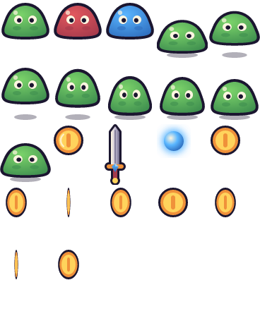
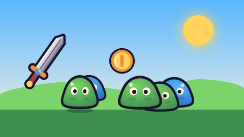
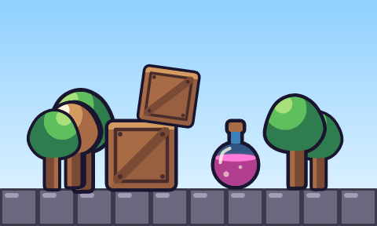
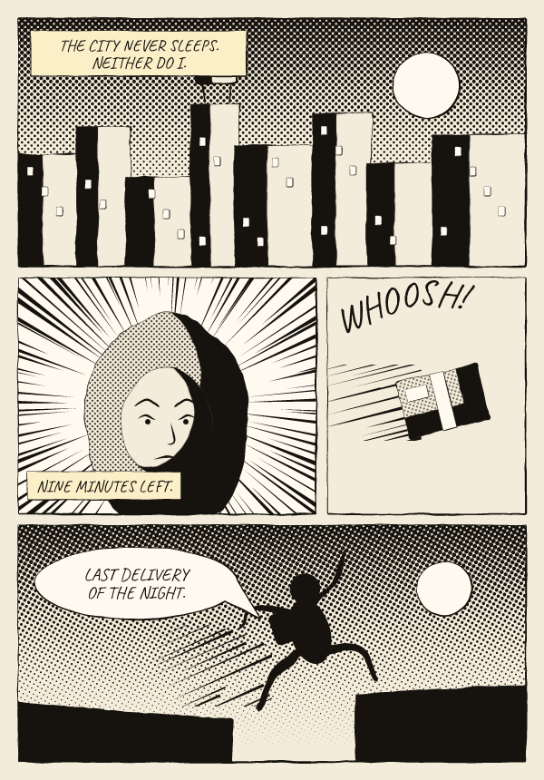

# vex

**2D vector game art as code.** Write a small `.vx.js` file of shapes, parts and variants;
vex exports SVG + PNG for every asset, animation strips and sprite atlases with
TexturePacker/Aseprite-style JSON, and previews with coordinate rulers that an AI agent can read.
A live viewer rebuilds on save and replays each asset step by step.

Built for AI agents (it ships as a Claude Code skill) and just as usable by hand.

> Part of a family: **vex** (vector art), [**pxl**](https://github.com/uilianks/pxl) (pixel art), [**chirp**](https://github.com/uilianks/chirp) (game audio), [**kiln**](https://github.com/uilianks/kiln) (low-poly and voxel 3D) and [**loom**](https://github.com/uilianks/loom) (seamless textures and PBR materials).
>
> Inspired by [**claude-pxl**](https://github.com/crsolver/claude-pxl) by crsolver, a pixel-art
> DSL for agents. vex takes its architecture (sandboxed art files, lazy cached builds, located
> errors, live painting viewer) and redesigns it for vectors: smooth shapes, gradients, glow,
> silhouette outlines, transforms, procedural animation, grain and blend modes.

## Showcase

Everything below was written as code in vex. Sources are in [`showcase/`](showcase/).

### Hand-drawn: ink, paint and hatching


Source: [`hand_drawn.vx.js`](showcase/hand_drawn.vx.js). Ordinary vex shapes with three style
keys: `ink` (a wobbly line whose weight follows the light and tapers at the ends), `shade` (form
shadow, highlight, rim light and brush texture from one light direction, colors from the palette
ramps) and `hatch`. Anims can `boil` the lines, and Spine export keeps the look on every bone.

### LAST CUP: a cyberpunk noir scene


1920×1080 still: [`last_cup.png`](docs/media/last_cup.png) · 10 s 1080p loop: [`last_cup.mp4`](docs/media/last_cup.mp4) ·
source: [`noir_cafe.vx.js`](showcase/noir_cafe.vx.js)

Rain on the glass, a backwards neon sign with a dying letter, flickering CRT, smoke and steam,
film grain, all procedural and looping.

### Skeletal animation


The Forest Kit hero as a 13-bone rig: hips, torso, head, two-part arms and legs, and a sword in
his hand. Five keyframed clips with easing, exported like any vex anim (strips, atlas + JSON).
Source: [`rigged.vx.js`](showcase/rigged.vx.js)

```js
const HERO = rig({
  torso:    { pivot: [24, 40], z: 4, items: [rect(19, 24, 10, 16, { fill: "tn1", r: 3.5 })] },
  armF:     { parent: "torso", pivot: [24, 28], z: 8, items: [line([24, 28, 24, 35], { stroke: "tn1", sw: 4 })] },
  forearmF: { parent: "armF", pivot: [24, 35], z: 8, items: [line([24, 35, 24, 41], { stroke: "sk1", sw: 3.6 })] },
})
anim("hero_walk", { w: 48, h: 64, frames: 8, fps: 10 }, pose(HERO, {
  armF: { rot: [[0, 22], [4, -22], [8, 22]] },          // [frame, degrees, ease into the next key]
  forearmF: { rot: [[0, -20], [4, -40], [8, -20]] },
}))
```

The same rig exports to **Spine 4.1** (`spine("hero", HERO, { clips })`): a skeleton JSON plus an atlas,
checked in the official Spine web player, so the animations run in any engine with a Spine runtime.

The same rig drives the LAST CUP robot's arm: ▶ **[watch him drink, 10 s with sound](docs/media/last_cup_sip.mp4)**.
A shoulder, elbow, hand and cup chain lifts the mug to his jaw while the cup bone counter-rotates
to keep the coffee level, and the room keeps its own 2 s rhythm of rain, flicker and grain.

### UI kit


Stretchable 9-slice panels, buttons, bars and slots with margins exported for Godot, Unity and Phaser,
icons, and **bitmap fonts** (BMFont .fnt + .xml + atlas) with outline and shadow, all verified
in Phaser: its own `nineslice` objects and `bitmapText` using the exported files.
Source: [`ui_kit.vx.js`](showcase/ui_kit.vx.js)


### Visual effects


A deterministic particle system: spawn rates or bursts, life, speed, angle, gravity, drag, size, color and
opacity over life, sparks stretched along their velocity, glow and blend modes. Loops are seamless.
Source: [`vfx.vx.js`](showcase/vfx.vx.js)

### Levels


ASCII maps with a legend: autotiled terrain (grass tops, dirt fill, rounded caps), fixed tiles, and game
objects with types and properties. Maps can be generated with plain JS. Levels export to **Tiled**
(.tmj / .tmx + tileset), verified by loading them in Phaser 3. Source: [`levels.vx.js`](showcase/levels.vx.js)

```js
level("stage1", { tileset: "forest", legend: { "#": platformer({...}), "c": { object: "coin", type: "coin" } }, map: `
  ....c.c....
  ..#######..
  ###########` })
```

### Forest Kit: a game-ready platformer pack


Characters, enemies, collectibles, props, seamless tiles, parallax layers and UI in one style.
Every asset is exported as SVG and PNG @1x/@2x, with atlases + JSON.
Source: [`forest_kit.vx.js`](showcase/forest_kit.vx.js)

| Character atlas | Tile atlas (seamless) |
|---|---|
|  |  |

## Quick start

```bash
git clone https://github.com/uilianks/vex && cd vex
npm install
node bin/vex.js build examples/basics.vx.js        # -> examples/out/
node bin/vex.js serve showcase/noir_cafe.vx.js     # live viewer on http://127.0.0.1:4322
```

In the viewer, **✎ annotate** (or `a`) lets you draw on the art and pin notes, then *send to Claude*:
the marks land in `out/_feedback/` in the art's own units, so "check the feedback" is all the agent
needs to hear.

Requires Node ≥ 22.18 (it runs the TypeScript sources directly). PNGs are rendered with
[resvg](https://github.com/linebender/resvg), so every PNG is a faithful rendering of its SVG.

```js
pal({ k: "#1b1630", g: "#7bd36a", G: "#3f8f4f", w: "#fff6e0", r: "#e2585e", R: "#a63a4c" })

sprite("slime", { w: 32, h: 26, outline: "k" },
  blob([16, 2, 24, 5, 29, 13, 30, 22, 16, 24, 2, 22, 3, 13, 8, 5], { fill: rad(["g", "G"], { cx: 0.4, cy: 0.3 }) }),
  sym(16, circle(11, 12, 3, "w"), circle(11.6, 12.4, 1.6, "k")))
sprite("slime_red", { base: "slime", swap: { g: "r", G: "R" } })

anim("slime_hop", { w: 36, h: 42, frames: 8, fps: 10 },
  (f) => stamp("slime", 18, 38 - Math.max(0, f.sin(8)), { anchor: "bottom" }))

sheet("enemies", ["slime*", "slime_hop"], { scale: 2 })
```

## Examples

Built by `npm run examples` from the files in [`examples/`](examples); the images are written to
[`docs/examples/`](docs/examples) by the same run.

**Sprites, variants, an anim and an atlas** ([`examples/basics.vx.js`](examples/basics.vx.js)): a slime
from one `blob`, recolored by `swap`, hopping in an anim, everything packed into an atlas (with
`--godot`, also a `SpriteFrames` for Godot).

```js
sprite("slime", { w: 32, h: 26, outline: "k" },
  blob([16, 2, 24, 5, 29, 13, 30, 22, 16, 24, 2, 22, 3, 13, 8, 5], { fill: rad(["g", "G"], { cx: 0.4, cy: 0.3, r: 0.8 }) }),
  sym(16,
    ellipse(10, 18, 3, 1.5, { fill: "G", opacity: 0.6 }),           // cheek shade
    circle(11, 12, 3, "w"), circle(11.6, 12.4, 1.6, "k")),          // eyes
  circle(9, 7, 1.6, { fill: "w", opacity: 0.7 }))                   // shine (one side only)

sprite("slime_red", { base: "slime", swap: { g: "r", G: "R" } })
sprite("slime_blue", { base: "slime", swap: { g: "b", G: "B" } })

anim("slime_hop", { w: 36, h: 42, frames: 8, fps: 10 },
  (f) => ellipse(18, 39, 11 - Math.max(0, f.sin(3)), 2, { fill: "#1b163055" }),      // shadow
  (f) => stamp("slime", 18, 38 - Math.max(0, f.sin(8)), { anchor: "bottom", scale: [1 + f.cos(0.08), 1 - f.cos(0.08)] }))

scene("meadow", { w: 160, h: 90, bg: lin(["b", "w"], 90) },
  circle(130, 20, 10, { fill: "y", glow: { r: 8, color: "y" } }),
  blob([0, 62, 40, 54, 90, 60, 130, 52, 160, 58, 160, 90, 0, 90], { fill: "g", smooth: 0.6 }),
  rect(0, 72, 160, 18, "G"),
  scatter("slime*", 10, 66, 140, 10, 5, { anchor: "bottom", scale: [0.6, 0.9], flip: "x" }),
  stamp("coin", 80, 40, { anchor: "center", scale: 0.8 }),
  stamp("sword", 30, 40, { anchor: "center", rot: 35 }))

sheet("items", ["slime*", "coin", "sword", "orb", "coin_spin"], { pad: 2, scale: 2 })
```

| `items` atlas, as built | `meadow` scene |
|---|---|
|  |  |

**Cel-shaded props in a scene** ([`examples/props.vx.js`](examples/props.vx.js)): tones clipped to the
base shape, tiles, a weighted random group scattered along the ground.

```js
// Cel shading: base shape, then darker / lighter tones clipped to it.
sprite("crate", { w: 28, h: 28, outline: "k", ow: 1.5 },
  rect(0, 0, 28, 28, { fill: "wd2", r: 2 }),
  clip(rect(0, 0, 28, 28, { fill: "k", r: 2 }),
    poly([28, 0, 28, 28, 0, 28], { fill: dark("wd2"), opacity: 0.35 }),  // shadow half
    rect(0, 0, 28, 3, lite("wd2"))),                                     // top light
  rect(3, 3, 22, 22, { stroke: "wd0", sw: 1.5 }),
  line([4, 24, 24, 4], { stroke: "wd1", sw: 4 }),
  sym(14, circle(5, 5, 1, "wd0"), circle(5, 23, 1, "wd0")))
```



**A comic page in ink** ([`examples/comic.vx.js`](examples/comic.vx.js)): `panels()` lays out the
page and `panel()` clips each one; pressure ink (`pressure: "bend"`), screentone (`tone`, flat and
fading), spot blacks (`spot`), radial and parallel `speedlines()`, balloons and captions lettered in
a handwriting font. The face panel:

```js
const P = panels({ w: 600, h: 860, margin: 20, gutter: 12, rows: [1, [3, 2], 1], heights: [1.05, 1, 1] })

// 2. Close-up: radial speed lines push in on the courier's face.
const face = [
  rect(0, 0, 329, 261, { fill: "w" }),
  speedlines({ area: [0, 0, 329, 261], at: [164, 140], count: 110, w: 7, inner: 0.62, seed: 4 }),
  blob([164, 40, 238, 88, 252, 180, 214, 262, 114, 262, 76, 180, 90, 88], { fill: "p", tone: { c: "k", gap: 4, dot: 0.5 }, ink: INK(5, { pressure: "bend" }), spot: { light: 300, depth: 0.22 } }),
  ellipse(164, 160, 50, 60, { fill: "p", ink: INK(3.5, { pressure: "bend" }), spot: { light: 300, depth: 0.16 } }),
  sym(164,
    curve([128, 142, 142, 136, 156, 143], { ink: INK(5, { pressure: [0.2, 1, 0.5], taper: 0.1 }) }),           // brow, pulled down
    curve([132, 156, 142, 152, 152, 157], { ink: INK(3, { pressure: [0.3, 1, 0.3] }) }),                         // lid
    circle(143, 159, 3, "k")),
  curve([168, 160, 172, 180, 164, 184], { ink: INK(2.5, { pressure: [0.2, 1, 0.6] }) }),                        // nose
  curve([148, 200, 164, 197, 180, 201], { ink: INK(3, { pressure: [0.3, 1, 0.3] }) }),                          // mouth
  caption(10, 214, 170, ["NINE MINUTES LEFT."]),
]

scene("comic_page", { w: 600, h: 860, bg: "p" },
  panel(P[0], { ink: true }, city),
  panel(P[1], { ink: true }, face),
  panel(P[2], { ink: true }, parcel),
  panel(P[3], { ink: true }, leap))
```



## Features

- **Shapes:** `rect circle ellipse poly blob curve line path star ngon arc text`. `blob` and
  `curve` pass smoothly through their points, so organic shapes take a few numbers.
- **Paint:** palette keys and ramps, linear and radial gradients, `pat()` pattern fills from any asset
  (fabric, scales, halftone), glow, blur, procedural `grain`, `blend` modes.
- **Mixed media:** `image()` embeds PNG / JPEG / GIF (collage, photo backdrops, pxl sprites in vector
  scenes; the silhouette outline follows the pixels); `text` along a curve.
- **Generative:** `noise(x, y)`, `lsystem()` + `turtle()` (plants, fractals, coral, with branch depth
  for tapering strokes), `tween()` for shape morphing, and `radial()` symmetry (mandalas, snowflakes).
- **Hand-drawn:** `ink` lines with weight, taper, wobble and brush `pressure`, painted `shade` from one
  light, `hatch`, and line `boil` in anims.
- **Comics:** `panels()` page layouts and `panel()` frames, screentone (`tone`, flat or fading), spot
  blacks (`spot`), focus and motion `speedlines()`, balloons and lettering.
- **Structure:** `tf` transform groups, `sym` mirroring, `clip` for cel shading and highlights,
  automatic silhouette `outline`.
- **Reuse:** parts, `base` + `swap` variants, `stamp`, `tile`, `scatter`, random groups and globs.
- **UI:** 9-slice metadata (`slice`) for Godot / Unity / Phaser and bitmap fonts (`font()`, BMFont),
  from a system font or from your own glyph sprites.
- **Particles:** `particles()` for fire, smoke, explosions, magic, hits and dust, as looping or one-shot anims.
- **Levels:** `tileset()` + `level()` with autotiling, game objects and generated maps; Tiled .tmj / .tmx export.
- **Skeletal animation:** `rig()` bone hierarchies with pivots and draw order, `pose()` with keyframed
  rotation, offset and scale clips, five easings, procedural channels, and Spine 4.1 export.
- **Animation:** `(f) => items` functions per frame (`f.t`, `f.sin`, `f.cos`, `f.rng`). Anims
  stamped inside anims follow their frames.
- **Output:** SVG, PNG at any scale, animation strips, atlases + JSON for Phaser, PixiJS, Godot
  and similar engines (`--godot` adds a `SpriteFrames` `.tres` per strip and atlas), agent-readable
  previews (`.gdignore`d).
- **Errors** name `file:line:col` and the asset path, and suggest fixes. One broken asset never
  stops the others.

Agent workflow: [SKILL.md](SKILL.md) · Full API: [reference.md](reference.md)

## Use as a Claude Code skill

```bash
ln -s "$PWD" ~/.claude/skills/vex-vector-art
```

## Development

```bash
npm run check      # typecheck + tests + build every example (npm run examples: also refreshes docs/examples)
```

## License

[MIT](LICENSE). Portions adapted from [claude-pxl](https://github.com/crsolver/claude-pxl)
(MIT, © crsolver).

## Support

If this tool helps you, you can support its development on [Ko-fi](https://ko-fi.com/uiliankidricki).
